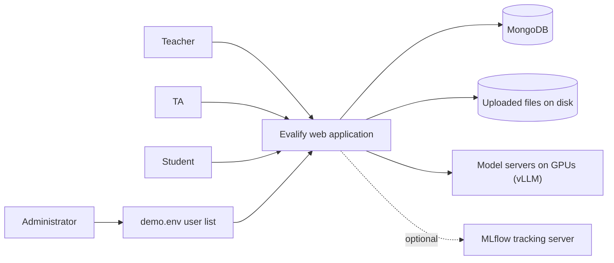
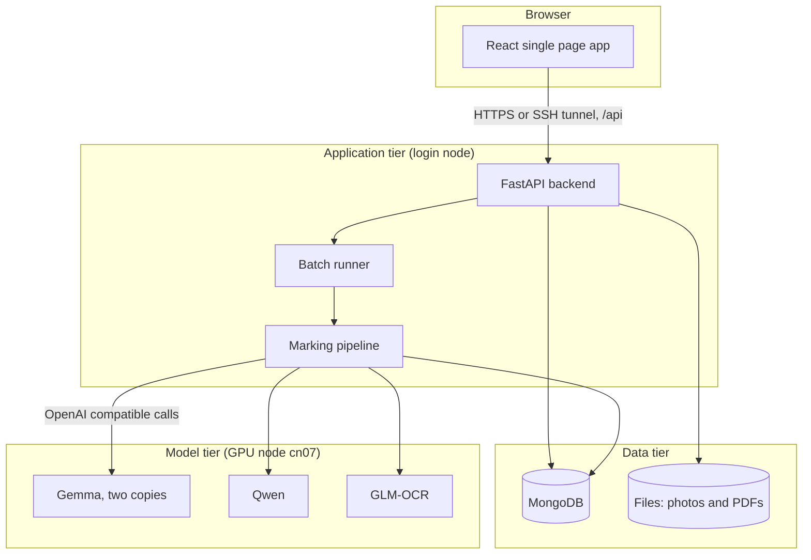
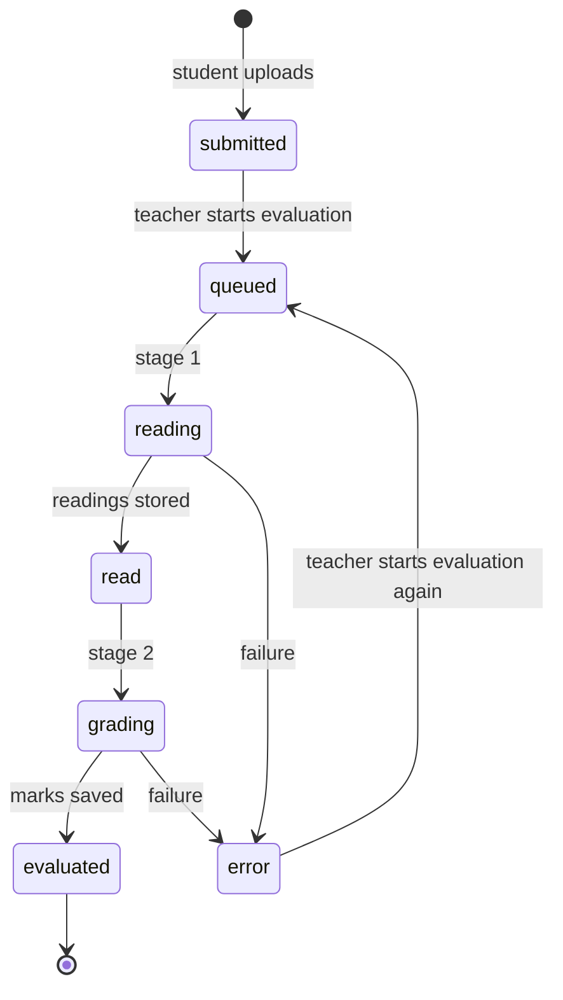
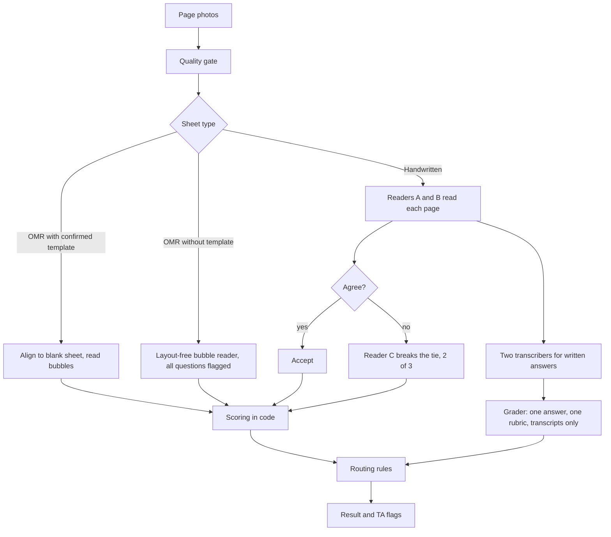
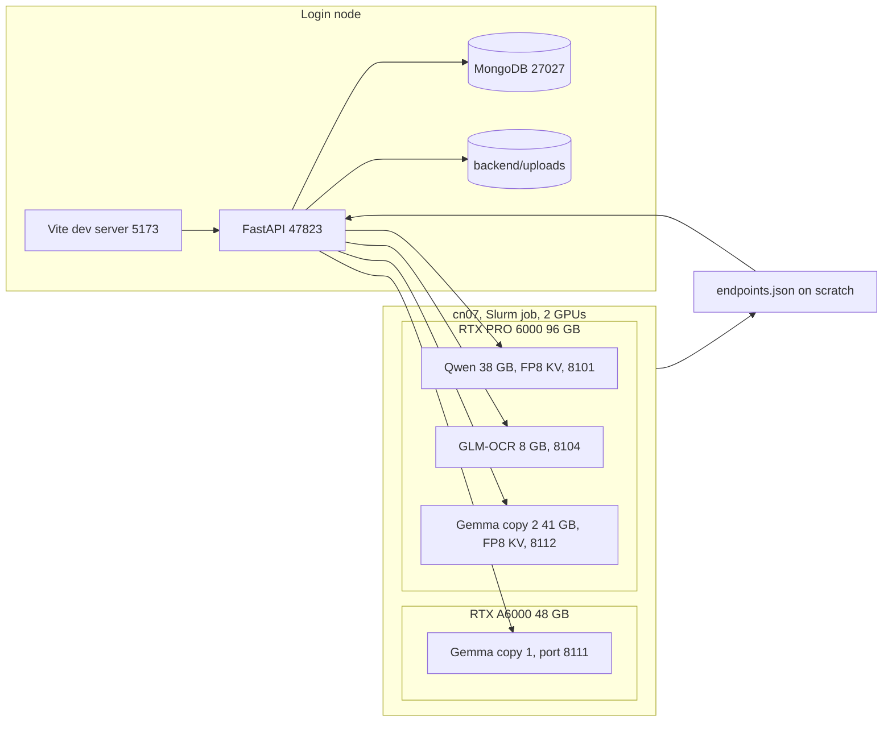

# Evalify: Detailed High Level Design

Version: 17 Nov 2026, branch `pipeline-v2`. Authors: project team (m25csa019, m25csa021).
This document describes how Evalify is built and why. The diagrams referred to here are in
[02_Mermaid_Diagrams.md](02_Mermaid_Diagrams.md) and [03_Sequence_Diagrams.md](03_Sequence_Diagrams.md).

## Contents

1. Purpose and scope
2. Requirements
3. System context
4. Architecture overview
5. Component design
6. Data design
7. Evaluation pipeline design
8. Model serving and deployment
9. Security and access control
10. Reliability and failure handling
11. Performance and capacity
12. Design decisions and trade-offs
13. Known limitations and open items
14. Where things are in the repository

---

## 1. Purpose and scope

Evalify marks photographed exam answer sheets. A teacher creates a paper (question paper, answer key, rubrics).
Students upload photos of their filled sheets. When the teacher starts the evaluation, the system reads every sheet,
marks MCQ and numerical answers in code, grades written answers against the rubric with a language model, and sends
everything it is unsure of to a teaching assistant (TA). The teacher releases the final marks to the students.

In scope: the web application, the marking pipeline, the model serving set-up on the IIT Jodhpur GPU cluster, and the
evaluation harness used to choose the models.

Out of scope for now: an exam schedule and upload window, a lock that holds the release until the TA work is done,
user administration screens (users come from `demo.env`), and production deployment on Kubernetes (only a namespace
file exists in `k8s/`).

### Roles

| Role | Signs in with | Responsibilities |
|---|---|---|
| Teacher | email and password | Creates papers, starts the evaluation, hand-marks, calibrates, releases results |
| TA | email and password | Reviews questions flagged by the system, answers re-evaluation requests |
| Student | roll number and password | Uploads answer sheets, sees released marks, asks once for re-evaluation |

### Paper types

| Type | Questions | Marking |
|---|---|---|
| 1, MCQ only | OMR bubble sheet or handwritten answers | OMR reader in code, or vision models reading the page |
| 2, MCQ and numerical | handwritten | Vision models read, code compares with the key (value within tolerance, unit ignored) |
| 3, MCQ, numerical and written | handwritten | As type 2, plus written answers transcribed and graded against the rubric |

## 2. Requirements

### Functional

| Id | Requirement |
|---|---|
| F1 | A teacher creates a paper of any of the three types with answer keys, rubrics and reference PDFs |
| F2 | A student uploads photos of an answer sheet; marking does not start until the teacher says so |
| F3 | The teacher starts the evaluation for a paper; all waiting sheets are processed as one batch with visible progress |
| F4 | MCQ, numerical and written answers are marked; OMR sheets are read from the bubbles |
| F5 | Answers the system is unsure of go to a TA with one stated reason each |
| F6 | The TA and the teacher can change marks; every change keeps its history |
| F7 | The teacher releases the marks; students see them only after that |
| F8 | A student can ask once for a re-evaluation; a TA answers it |
| F9 | The teacher can calibrate written-answer marks to their own marking style |
| F10 | An optional assistant drafts reference answers and rubric points from the teacher's notes (type 3 papers only) |

### Non-functional

| Id | Requirement | How it is met |
|---|---|---|
| N1 | Marking must not silently be wrong | Two independent readers, majority of three on disagreement, flags for the TA, random spot check |
| N2 | A class of hundreds of sheets finishes in hours, not days | Batch of 32 sheets in flight per stage, two Gemma copies, measured in section 11 |
| N3 | Works without internet and without external APIs | Open models served on our own GPUs |
| N4 | The application keeps working when parts are down | Graceful degradation (section 10) |
| N5 | Student photos stay on our servers | Files on the cluster disk, models run locally |
| N6 | Every part is testable without GPUs or a database server | In-memory database in tests, models stubbed |

## 3. System context

The application is the only thing users touch. It talks to MongoDB for data, the cluster disk for photos and PDFs, and
the model servers for reading and grading. MLflow is optional and best effort. The administrator edits `demo.env`
to add users (no screens for this yet).

## 4. Architecture overview

Evalify is a three tier web application with a separate model serving tier.

Principles behind the design:

1. **Store first, evaluate later.** An upload only saves the sheet. The teacher decides when to run the evaluation.
2. **Read everything, then grade everything.** The batch has two stages so the grading stage has the GPUs to itself.
3. **Numbers are computed by code, language is judged by models.** MCQ and numerical marks never depend on a model's opinion.
4. **Two opinions before trusting a reading.** Independent readers from different model families, with a third as tie-breaker.
5. **Say when unsure.** Every doubtful answer carries one reason and goes to a person.
6. **Degrade, do not break.** A missing model or service reduces what is possible but never loses data.

## 5. Component design

### 5.1 Frontend

React 18 with Vite, Tailwind and Zustand for login state, Axios for the API. The dev server proxies `/api` to the
backend, so no backend address is configured in the browser code. Pages are grouped by role.

| Area | Screens |
|---|---|
| Login | Teacher, student and TA login pages |
| Teacher | Home, create paper (5 step wizard), paper page, results page with the Start evaluation panel and release panel |
| TA | Review queues (Flagged by AI, Re-evaluation requests), review page for one sheet |
| Student | Subjects, paper list, upload page, result page with re-evaluation request |

The wizard counts the questions of the uploaded question paper, asks whether MCQ papers use an OMR or handwritten
sheet, and requires a confirmed blank OMR sheet for OMR papers. Reusable pieces live in `components/` (ui, layout,
forms, results). A test enforces that no emoji appears anywhere in the interface.

### 5.2 Backend

FastAPI application (`backend/app/main.py`). At start-up it connects to MongoDB, creates the users listed in
`demo.env`, and resumes any batch that a restart cut off.

| Router | Responsibility |
|---|---|
| `auth` | Login for the three roles, JWT creation, role dependencies |
| `papers` | Paper CRUD, file uploads, answer-key and rubric extraction, question counting, OMR template building, release, answer-key assistant |
| `submissions` | Student uploads, page images, status polling, re-evaluation request |
| `evaluation` | The teacher's Start evaluation and its progress |
| `results` | Results per paper (teacher) and per sheet (student, teacher, TA) |
| `ta` | TA subjects, queues, review items and final marks |
| `calibration` | Teacher calibration of written-answer marks |

| Service | Responsibility |
|---|---|
| `batch_runner` | Runs a batch in two stages with bounded concurrency, records progress, recovers after restarts, marks crashed sheets as errors |
| `evaluator` | Evaluates one sheet (read stage and grade stage), stores the result, logs to MLflow in a worker thread |
| `access` | Who may see a sheet, and the status a student sees |
| `marks` | Mark changes by TA or teacher with validation and history |
| `answer_key` | Retrieval and drafting for the answer-key assistant |
| `rubric_extractor`, `pdf_utils`, `omr_engine` | PDF and rubric parsing, layout-free OMR reader |

### 5.3 Marking pipeline

`backend/app/pipeline/` holds the logic that turns photos into marks. `orchestrator.read_sheet` runs stage 1 (quality
gate and reading) and `orchestrator.grade_sheet` runs stage 2 (scoring, grading and flags). The state between the stages
is stored in MongoDB so a restart loses nothing. Details are in section 7.

### 5.4 Model serving

One vLLM server per model, each speaking the OpenAI-compatible HTTP API. `pipeline/llm.py` maps roles (page reader A,
page reader B, page reader C, transcribers, grader) to models using `infra/models.yaml`, finds each server through an
endpoints file written by the GPU job, checks health with a short cache, sends each request to the least busy copy of a
model, and re-sends a request that a smaller copy refuses as too long.

### 5.5 Data stores

MongoDB holds users, papers, submissions and batches. Photos and PDFs are plain files under `backend/uploads`.
MLflow, when running, holds one run per evaluated sheet.

## 6. Data design

Four collections. The full entity diagram is in the Mermaid file.

| Collection | Key fields |
|---|---|
| `users` | role, email or roll_no, name, subject(s), password hash |
| `papers` | teacher_id, name, subject, type, question counts and marks, answer keys, rubrics, uploaded file URLs, `omrTemplate`, `answerSheetFormat`, config, `resultsReleased`, calibration |
| `submissions` | paper_id, student, page file paths, sheet_type, status, batch_id, `read_state`, result and per-question details, review flags, `ta_review`, `reevaluation`, marks history, pipeline record |
| `batches` | paper_id, teacher_id, status, stage, total, created_at, finished_at, error |

### Sheet life cycle

The student sees "Submitted" while waiting, "being evaluated" during the batch and until the release, and the marks
after the release. TA review and re-evaluation are fields on an evaluated sheet, not separate states.

## 7. Evaluation pipeline design

Key choices and the reasons for them:

| Choice | Reason |
|---|---|
| Whole-page reading, no answer crops | Measured better in runs 5 to 9 and simpler than cropping each answer |
| Readers from different families (Gemma, Qwen) with GLM-OCR as tie-breaker | Different models rarely make the same mistake |
| MCQ marks by exact set match, numerical by value within tolerance, unit ignored | Deterministic, explainable, no model opinion involved |
| One grader (Gemma with prompt v2), transcripts only | A second grader added no accuracy in run 7; showing only the transcript keeps other answers out of the grade |
| Optional per-question calibration shift | Matches the teacher's marking strictness without changing the grader |
| Routing rules produce one reason per flagged question | A TA sees why, and thresholds can be tuned from the data |
| Random spot check of accepted written answers (default 5 %) | Grader confidence did not predict wrong marks, so random checks measure quality |

Reasons a question is flagged: page failed the quality gate, readers disagree or abstain, low reader confidence,
thin OMR margin (half-filled bubble), every option read as filled, OMR template not confirmed, grader doubt on a
concept, or the random spot check.

OMR: the teacher uploads a blank sheet, the system learns the bubble map and the teacher confirms it. Sheet photos are
aligned to the blank sheet and read at the known bubble positions. This is required for OMR papers.

## 8. Model serving and deployment

| Item | Detail |
|---|---|
| Production layout (`tier1` in `infra/models.yaml`) | Gemma on the A6000. Qwen, GLM-OCR and a second Gemma copy on the PRO 6000. Qwen and the second Gemma store attention memory in FP8. The second Gemma accepts at most 8,192 tokens per request |
| Why two Gemma copies | Gemma reads, transcribes and grades, so it is the bottleneck on papers with written answers. Measured +32 to 38 % sheets per hour with marks unchanged |
| Safeguard | A request the second copy refuses as too long is re-sent to the first copy |
| Previous layout | `tier1-single`: one Gemma copy and Qwen with 76 GB |
| Discovery | The GPU job writes `endpoints.json` (or `endpoints-opt.json` for the experiment job) listing each live server. The backend reads it and caches health checks for 60 s |
| Launching | `infra/cluster/serve_models.sbatch` (production) and `serve_switch.sbatch` (experiments with switchable profiles) call `serve.py`, which places each server on a GPU with memory shares taken from the profile |
| Application services | `infra/cluster/app.sh` starts MongoDB (user space, authentication on), the backend and the frontend on the login node |
| Storage rule | Everything heavy (Python environments, model weights, caches, logs, database files) lives on `/scratch`, because the GPU node reads the home directory very slowly |
| Limits | At most 2 GPUs per user. Release the GPU job when finished |

The Docker compose file and Kubernetes namespace are left from the earlier design and are not used on the cluster.

## 9. Security and access control

| Topic | Design |
|---|---|
| Authentication | JWT (HS256), one secret per role, expiry 8 h (teacher, TA) and 4 h (student). Passwords hashed with bcrypt |
| Authorisation | Role dependencies on every route. A student sees only their own sheets, a teacher only their own papers, a TA only sheets of their subjects |
| Enrolment | A student can upload only to papers of subjects they are enrolled in |
| Release | Students never receive marks of a paper that is not released |
| Data location | Photos and marks stay on the cluster. The models run locally, nothing is sent to outside services |
| Database | MongoDB listens on 127.0.0.1 only, with authentication. The password is kept in a file readable only by its owner and never committed |
| Datasets | Datasets with personal data (real student names) are not used. Public datasets are used for internal evaluation only, within their licences |
| Secrets | Default JWT secrets are placeholders and must be replaced on any shared machine |

## 10. Reliability and failure handling

| Situation | Behaviour |
|---|---|
| A model server is down | Roles fall back along the list in `models.yaml`. With no reader at all, handwritten sheets fail with a reason and can be run again. OMR sheets still work |
| One sheet fails | It becomes an error with the reason and the batch carries on. The next Start evaluation includes it again |
| The batch crashes | The batch is marked failed with the error, unfinished sheets become errors, finished sheets keep their marks |
| The backend restarts mid-batch | At start-up, sheets in a stage go back one step and every running batch continues from where it stopped |
| MLflow is down | Logging gives up in seconds, runs in a worker thread and pauses for 60 s after a failure. Evaluation is unaffected |
| An OMR template was never confirmed | It is ignored and every question is flagged for a TA |
| A reading is implausible (all options filled) | The question is flagged instead of silently scored |
| Two clicks on Start evaluation | The second is refused while a batch for the paper is running |

## 11. Performance and capacity

Measured on cn07 with the production layout (see `INFERENCE_OPTIMIZATION.md` and `eval/reports/RESULTS.md`).

| Workload | Throughput | Notes |
|---|---|---|
| One page MCQ sheets | about 2,000 to 2,300 sheets per hour | 16 to 32 sheets in flight |
| Data Science paper (20 MCQ, 15 written, about 3.5 pages) | 206 to 217 sheets per hour | with the second Gemma copy, up from about 156 |
| OMR sheet with template | reading takes about 5 s for one sheet | no model calls |

A class of 700 Data Science sheets takes about 3.3 hours. The batch size is set by `EVALIFY_BATCH_CONCURRENCY`
(default 32). Quality against the labelled sets is in the reports: for example, written-answer error about 0.65 marks,
MCQ and numerical accuracy 97.6 %.

## 12. Design decisions and trade-offs

| Decision | Alternative | Why this way |
|---|---|---|
| Teacher starts the evaluation for the whole class | Evaluate each upload at once | Reading first and grading second uses the GPUs better and the teacher controls timing |
| Open models on our own GPUs | A paid vision API | Student data stays on site and cost per sheet is low |
| Second Gemma copy with FP8 memory | One bigger copy or a different model | Largest measured gain, same marks. Cost: Qwen has less room, one-page sheets gain nothing |
| Template required for OMR | Layout-free reading only | The layout-free reader misread a skewed phone photo almost completely (0 of 20 on a real sheet); with the template the same sheet scored 20 of 20. The template read all 10 sheets of layouts 1 and 2 perfectly in the latest check (99.7 % over all 15 sheets in the earlier run; layout 3 is an open item) |
| MongoDB documents | A relational database | Papers have several shapes and the pipeline adds fields without migrations |
| Users from `demo.env` | A user administration screen | Enough for the prototype, simpler to reproduce |
| MLflow optional | Required tracking | Keeps the application working when it is not running |

## 13. Known limitations and open items

| Item | State |
|---|---|
| OMR layout 3 | A quick re-check read 3 of 5 layout-3 sheets badly and without flags. Not yet investigated; layouts 1 and 2 were perfect |
| MLflow | Package installed, no server running on the cluster. Setting it up is postponed |
| Release lock | The teacher can release before TA work is done. A lock was discussed and postponed |
| Exam schedule and upload window | Not built (postponed by the user) |
| User administration | Users come from `demo.env`; no screens |
| Experiment GPU job | The running job is the experiment job on ports 82xx with the same layout as production. When it ends, start `serve_models.sbatch` and restart the backend without the endpoints override |
| Single machine | Backend, database and frontend run on one login node; there is no high availability |
| Defaults | JWT secrets are placeholders; replace them on shared machines |

## 14. Where things are in the repository

| Topic | Location |
|---|---|
| Backend application | `backend/app/` (routers, services, pipeline, prompts, models, db) |
| Backend tests | `backend/tests/` |
| Frontend | `frontend/src/` (pages, components, hooks, store) |
| Model registry and serving profiles | `infra/models.yaml` |
| Cluster scripts | `infra/cluster/` |
| Evaluation harness and reports | `eval/`, `eval/reports/RESULTS.md` |
| Pipeline plan | `V2_EVALIFY_PLAN.md` |
| Speed experiments | `INFERENCE_OPTIMIZATION.md` |
| Decision log | `decision.md` |
| Setup and usage | `README.md`, `MANUAL_CHECKLIST.md`, `uploads/README.md` |
