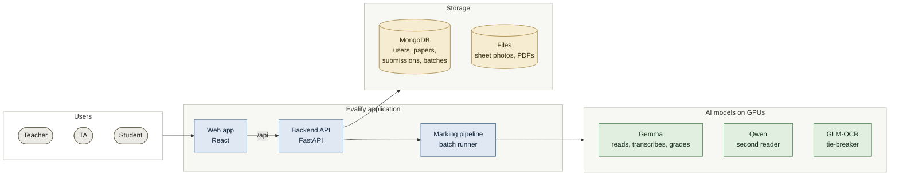
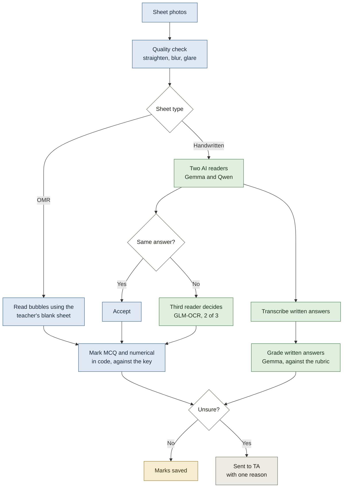
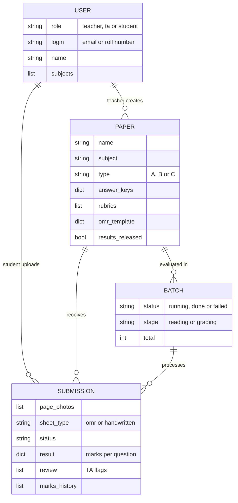
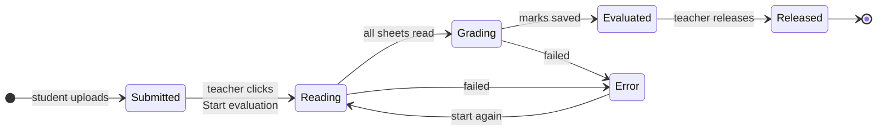
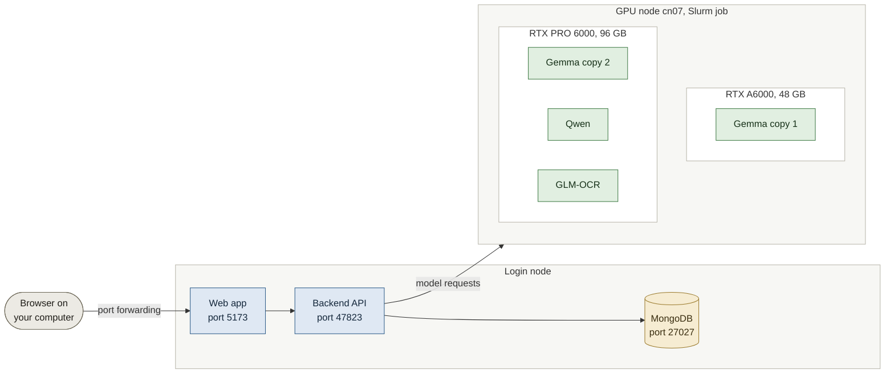

# Evalify: Architecture Diagrams

Five diagrams that together explain the system. Sequence diagrams (what happens over time) are in
[03_Sequence_Diagrams.md](03_Sequence_Diagrams.md). The written design is in
[01_High_Level_Design.md](01_High_Level_Design.md).

Colours used in every diagram: people in grey, the application in blue, data in yellow, AI models in green.

1. System architecture
2. Marking pipeline
3. Data model
4. Answer sheet life cycle
5. Deployment

---

## 1. System architecture

The three users work in one web application. The backend stores everything in MongoDB and on disk, and asks the
AI models on the GPU node to read and grade.

## 2. Marking pipeline

How one answer sheet becomes marks. Numbers are marked by code, language by the model, and anything doubtful goes to
a TA.

Reasons a question goes to the TA: a poor photo, the readers disagree, a half-filled bubble, every option looks
filled, the grader is unsure, or a random 5 % quality check.

## 3. Data model

Four collections in MongoDB. A teacher owns papers, a student owns submissions, and a batch groups the submissions of
one "Start evaluation".

## 4. Answer sheet life cycle

Uploads wait until the teacher starts the evaluation. Every sheet is read first, then graded. A failed sheet can be
sent again.

## 5. Deployment

Where each part runs on the IIT Jodhpur cluster. The user reaches the app through port forwarding.

The GPU job writes the address of each model into an endpoints file, and the backend reads it, so nothing is
configured by hand. Two copies of Gemma share its work because it does the most: reading, transcribing and grading;
each request goes to the less busy copy.
