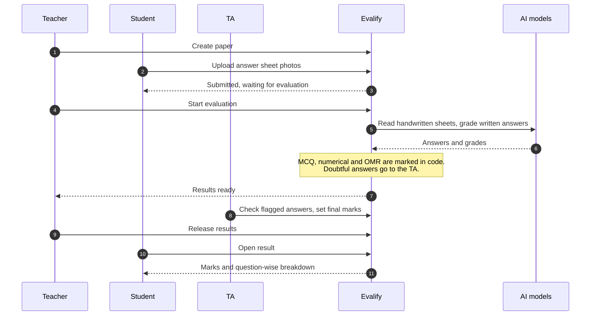
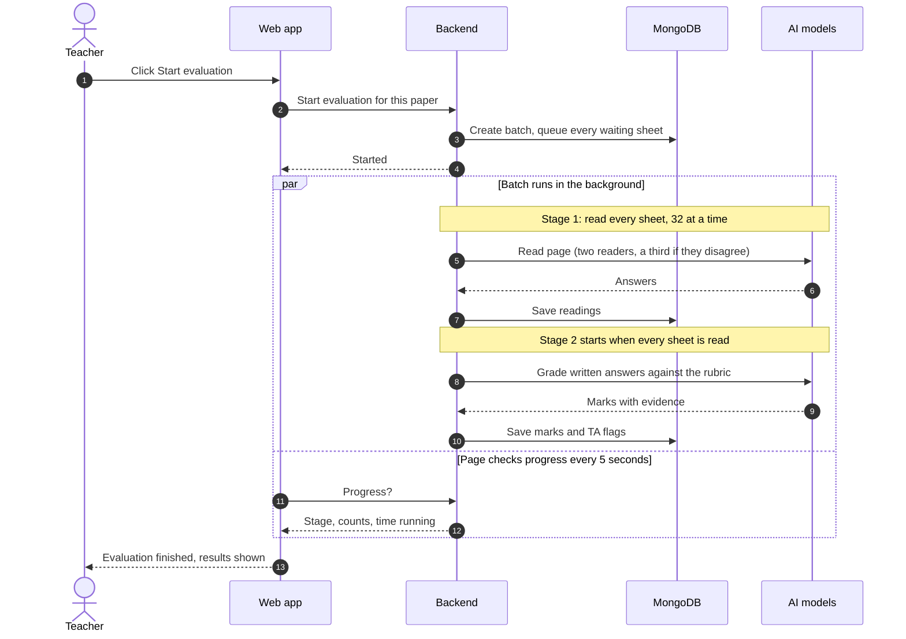
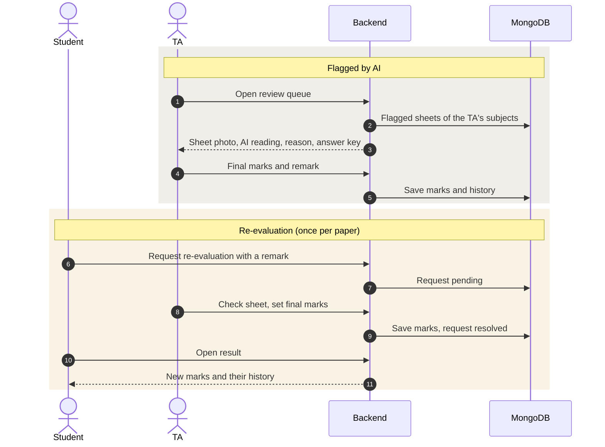
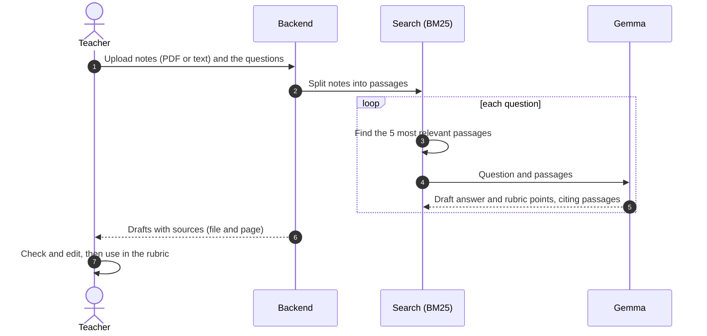

# Evalify: Sequence Diagrams

Four diagrams of what happens over time, from the whole round down to the details. The structure of the system is in
[02_Mermaid_Diagrams.md](02_Mermaid_Diagrams.md). The written design is in
[01_High_Level_Design.md](01_High_Level_Design.md).

1. One exam round, end to end
2. Start evaluation: the batch
3. TA review and re-evaluation
4. Answer-key assistant (RAG)

---

## 1. One exam round, end to end

The whole journey of a paper: the teacher creates it, students upload their sheets, the system marks them when the
teacher starts the evaluation, a TA checks the doubtful answers, and the teacher releases the marks. The picture
`images/06_sequence_exam_round.jpg` is the same diagram drawn in a hand-sketched style (`sketch/sketch06.mjs`).

## 2. Start evaluation: the batch

What happens after the teacher clicks the button. The batch runs in the background: every sheet is read first, then
every sheet is graded, 32 at a time. Meanwhile the page shows the progress. OMR sheets are read from the bubbles
without the AI models, and MCQ and numerical answers are marked in code.

If a sheet fails it is marked as an error and the rest carry on. The next Start evaluation picks it up again. If the
backend restarts, the batch continues from where it stopped.

## 3. TA review and re-evaluation

A TA checks what the system flagged. A student may ask once for a re-evaluation, which also goes to a TA. Every
change of marks is kept in the history.

## 4. Answer-key assistant (RAG)

Optional, for papers with written answers. It finds the right passages in the teacher's notes and drafts a reference
answer with rubric points. The teacher checks and edits the draft before using it.

